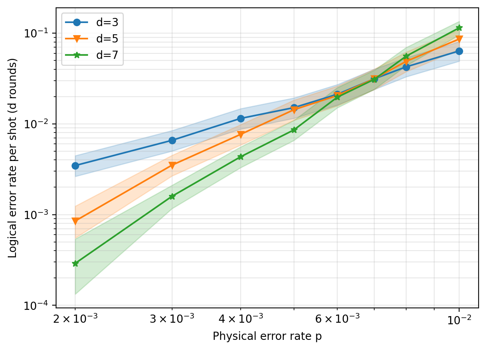
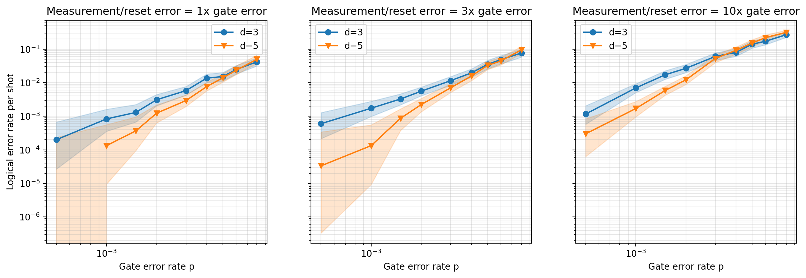

# Surface Code Memory Simulation with Stim

## Overview

This project investigates quantum error correction using rotated surface-code memory circuits simulated with [Stim](https://github.com/quantumlib/Stim) and decoded using [PyMatching](https://github.com/oscarhiggott/PyMatching).

The objective is to examine how logical error rates vary with code distance and physical noise, and to investigate the sensitivity of error-correction performance to measurement and reset errors.

## Methodology

- Generated rotated surface-code memory circuits at code distances \(d=3,5,7\).
- Applied uniform circuit-level depolarizing noise.
- Simulated circuit behavior across a range of physical error probabilities.
- Used PyMatching to decode detection events and estimate logical error rates.
- Compared performance across code distances to examine threshold behavior.
- Varied measurement and reset noise relative to gate noise to investigate its impact on logical error rates.

## Results

### 1. Baseline Noise Model

The logical-error-rate curves for code distances \(d=3\) and \(d=5\), and \(d=5\) and \(d=7\), cross at approximately 0.7% physical error probability.

Below the crossing, increasing code distance suppresses logical errors. Above the crossing, larger code distances exhibit higher logical error rates.

The crossings were estimated using linear interpolation on a coarse physical error-probability grid:

- \(d=3\) vs. \(d=5\): approximately 0.700%
- \(d=5\) vs. \(d=7\): approximately 0.709%

#### Baseline Threshold Plot



### 2. Measurement and Reset Noise

Measurement and reset error rates were scaled relative to the gate error rate to investigate their effect on the estimated threshold.

| Measurement/reset multiplier | Estimated d=3/5 crossing |
|---|---:|
| 1× | 0.65% |
| 3× | 0.66% |
| 10× | 0.35% |

The 3× measurement-noise setting produced no clearly detectable shift relative to the baseline. At 10×, the estimated crossing decreased substantially.

These results suggest that elevated measurement and reset noise can affect error-correction performance, although further simulations would be needed to characterize the relationship.

#### Measurement and Reset Noise Comparison



## Limitations

- Threshold estimates use a coarse physical error-probability grid and linear interpolation.
- Logical error rates are measured per memory experiment (a shot of \(d\) rounds), not normalized per round.
- A single decoding approach (PyMatching) was used.
- The noise model does not include leakage, correlated noise, or atom loss.
- Shot counts are modest, limiting statistical precision.
- The noise model is illustrative and is not calibrated to QuEra's neutral-atom hardware.

## Tools and Technologies

- Python
- Stim
- PyMatching
- NumPy
- Matplotlib
- Pandas

## Reproducibility

The main simulation notebook is provided as `surface_code_memory_simulation.ipynb`.

Install the required dependencies:

```bash
pip install -r requirements.txt
```

Run the notebook to reproduce the simulations, analysis, and plots.

